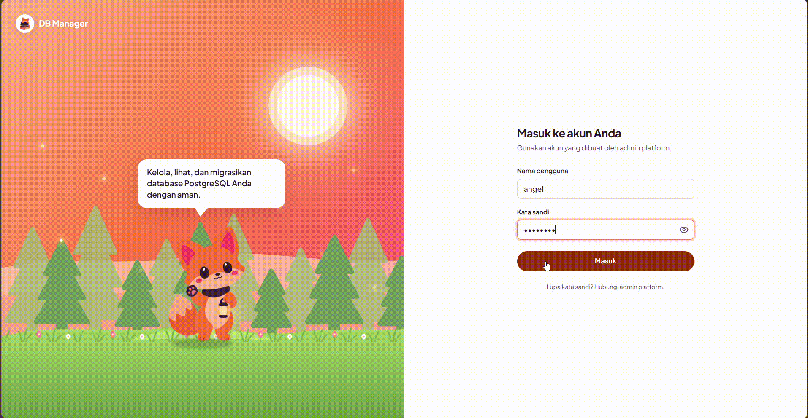

# Database Management Platform

Database Management Platform (DBMP) adalah aplikasi web untuk mengelola akses dan
perubahan pada database PostgreSQL dan MySQL. Milestone 1 IF3110 Pengembangan
Aplikasi Web mencakup akses berbasis grup, viewer baca saja, dan riwayat
migration. Milestone 2 menambahkan persetujuan leader untuk setiap revisi,
antrean migration yang diproses worker, dan eksekusi batch dengan checkpoint
untuk melanjutkan atau membatalkan perubahan.

## Preview Aplikasi

Cuplikan tampilan aplikasi DB Manager.



## Authors

| Nama | NIM |
|---|---|
| Stefani Angeline Oroh | 13524064 |
| Bryan Pratama Putra Hendra | 13524067 |
| Angelina Andra Alanna | 13524079 |

## Struktur Program

```text
.
├── backend/
│   ├── cmd/
│   │   ├── api/                    # HTTP API server
│   │   ├── worker/                 # Persistent migration queue worker
│   │   ├── bootstrap-admin/        # Membuat platform admin pertama
│   │   └── migrate/                # Menjalankan migration platform
│   ├── internal/
│   │   ├── app/                    # Komposisi dependency dan startup aplikasi
│   │   ├── auth/                   # Login, password, dan bootstrap admin
│   │   ├── authz/                  # Resolusi hak akses user ke database
│   │   ├── database/               # Managed database dan enkripsi credential
│   │   ├── group/                  # Group dan membership
│   │   ├── migration/              # Draft, eksekusi, EXPLAIN, dan recovery
│   │   ├── platformdb/             # Koneksi ke database internal platform
│   │   ├── schemadiff/             # Introspeksi dan perbandingan schema
│   │   ├── session/                # Session cookie dan lifecycle session
│   │   ├── targetdb/               # Koneksi dan driver target PostgreSQL/MySQL
│   │   ├── user/                   # Administrasi user
│   │   ├── viewer/                 # Schema, table, metadata, dan row viewer
│   │   └── shared/                 # Komponen bersama backend
│   ├── migrations/                 # Goose migration untuk schema platform
│   └── tests/integration/          # Pengujian dengan database nyata
├── database/
│   └── seeds/university/           # Dataset universitas untuk target PostgreSQL
├── frontend/
│   └── src/
│       ├── app/                    # Router, halaman utama, dan setup aplikasi
│       ├── components/             # Komponen UI bersama
│       ├── lib/                    # API client dan utilitas frontend
│       ├── modules/                # Fitur auth, admin, database, viewer, migration
│       └── styles/                 # Style global dan token tampilan
├── compose.yml                     # Seluruh service untuk development lokal
├── Makefile                        # Shortcut command development dan testing
└── .env.example                    # Contoh konfigurasi lokal
```

Backend mengelompokkan kode berdasarkan domain di `internal/`; frontend
mengelompokkan layar dan API berdasarkan fitur di `modules/`. Migration platform
berada di `backend/migrations/`, sedangkan migration yang dibuat pengguna
disimpan pada database platform dan dijalankan ke target yang dipilih.

## Fitur Milestone 1

- Login berbasis session cookie `HttpOnly` dengan proteksi CSRF.
- Platform admin untuk mengelola user, group, membership, dan managed database.
- Grant database berbasis group: `view_only` dan `view_edit`.
- PostgreSQL dan MySQL 8.4 viewer untuk schema, table/view, struktur, index, constraint, dan row.
- Migration history dengan draft, versioning, commit, rollback, dan recovery.
- Enkripsi credential managed database menggunakan AES-256-GCM.
- Unit test, integration test PostgreSQL/MySQL, dan frontend test.

## Teknologi

| Bagian | Teknologi |
|---|---|
| Backend | Go 1.26, `net/http`, pgx, go-sql-driver/mysql |
| Frontend | React 19, TypeScript, Vite, TanStack Query |
| Platform database | PostgreSQL 18 |
| Managed target | PostgreSQL 18 atau MySQL 8.4 |
| Migration internal | Goose |
| Runtime frontend Docker | Nginx |
| Package manager frontend | Bun 1.3 |

## Quick Start dengan Docker

Docker Compose menjalankan seluruh stack: platform database, target database,
migration internal, backend API, migration worker, dan frontend.

### 1. Siapkan environment

```bash
cp .env.example .env
```

Nilai pada `.env.example` hanya untuk development lokal. Jangan commit `.env`
atau memakai credential contoh di production.

Jika `.env` berasal dari versi repository yang lebih lama, pastikan variabel
berikut tersedia:

```dotenv
MANAGED_DB_CREDENTIAL_KEY=<base64 dari tepat 32 byte>
MANAGED_DB_CREDENTIAL_KEY_VERSION=1
BACKEND_PORT=8080
FRONTEND_PORT=5173
HTTP_WRITE_TIMEOUT=3m
```

Generate encryption key baru bila diperlukan:

```bash
openssl rand -base64 32
```

Jangan mengganti key setelah credential managed database tersimpan. Credential
lama tidak dapat didekripsi dengan key yang berbeda.

### 2. Jalankan seluruh aplikasi

```bash
docker compose up --build -d --wait
```

Alternatif melalui Makefile:

```bash
make app-up
```

Urutan startup dikelola melalui healthcheck dan dependency:

```text
platform-db ──healthy──> migrate ──completed──> backend ──healthy──> frontend
                    └────────────────────────> worker
target-db / mysql-target ────────────────────> backend dan worker
```

### 3. Buat admin pertama

Jalankan satu kali secara interaktif:

```bash
docker compose run --rm bootstrap-admin
```

atau:

```bash
make docker-bootstrap-admin
```

Password dibaca tanpa echo dan tidak disimpan pada image. Bootstrap akan ditolak
jika platform sudah memiliki admin aktif.

### 4. Buka aplikasi

- Frontend: `http://localhost:5173`
- Backend health: `http://localhost:8080/api/v1/health`
- Backend readiness: `http://localhost:8080/api/v1/ready`

Frontend Nginx meneruskan request `/api` ke backend melalui jaringan Compose,
sehingga browser tetap menggunakan origin frontend.

### 5. Daftarkan target database contoh

Karena backend berjalan di jaringan Compose, gunakan konfigurasi berikut pada
halaman **Admin → Databases**:

| Field | Nilai |
|---|---|
| Engine | `PostgreSQL` |
| Host | `target-db` |
| Port | `5432` |
| Database | nilai `TARGET_DB_NAME` |
| Username | nilai `TARGET_DB_USER` |
| Password | nilai `TARGET_DB_PASSWORD` |
| SSL mode | `disable` |

Jangan menggunakan `localhost:55433` dari backend container. `localhost` di
dalam container menunjuk ke container backend itu sendiri.

Target MySQL contoh dapat didaftarkan dengan engine `MySQL 8.4`, host
`mysql-target`, port `3306`, database/username/password dari variabel
`MYSQL_TARGET_DB_*`, dan SSL mode `disable`.

### 6. Isi target PostgreSQL dengan data universitas

Seed opsional ini membuat delapan schema domain, puluhan table/view, serta
ratusan ribu row untuk mencoba viewer, schema diff, migration, dan EXPLAIN:

```bash
make seed-university
```

Command dapat dijalankan ulang. Setiap eksekusi hanya menghapus dan membuat
ulang schema `campus`, `people`, `academics`, `admissions`, `finance`,
`library`, `research`, dan `reporting` pada `target-db`. Schema lain tidak
diubah. Rincian jumlah data dan contoh query tersedia di
[panduan seed universitas](./database/seeds/university/README.md).

## Operasional Docker

Lihat status seluruh service:

```bash
make app-status
```

Ikuti log backend dan frontend:

```bash
make app-logs
```

Lihat log service tertentu:

```bash
docker compose logs -f migrate
docker compose logs -f backend
docker compose logs -f frontend
```

Hentikan stack tanpa menghapus data:

```bash
make app-down
```

Build ulang setelah source berubah:

```bash
docker compose up --build -d --wait
```

Reset seluruh database lokal hanya jika datanya tidak lagi dibutuhkan:

```bash
docker compose down -v
```

Perintah terakhir menghapus user, session, grant, migration history, dan seluruh
data target lokal.

## Local Development dengan Hot Reload Frontend

Mode ini menjalankan PostgreSQL melalui Docker, tetapi backend dan frontend dari
host. Gunakan mode ini ketika aktif mengembangkan source.

### Prasyarat

- Go 1.26 atau lebih baru;
- Bun 1.3 atau lebih baru;
- Docker dengan Docker Compose v2.

Pastikan `.env` sudah dibuat mengikuti langkah **Siapkan environment** di atas.

Install dependency frontend:

```bash
make frontend-install
```

Jalankan database dan migration internal:

```bash
make db-up
make migrate-up
```

Buat admin pertama dari host:

```bash
make bootstrap-admin
```

Jalankan backend pada terminal pertama:

```bash
make backend-run
```

Jalankan Vite pada terminal kedua:

```bash
make frontend-dev
```

Dalam mode ini, managed target database menggunakan:

| Field | Nilai |
|---|---|
| Engine | `PostgreSQL` |
| Host | `localhost` |
| Port | nilai `TARGET_DB_PORT`, default `55433` |
| Database | nilai `TARGET_DB_NAME` |
| Username | nilai `TARGET_DB_USER` |
| Password | nilai `TARGET_DB_PASSWORD` |
| SSL mode | `disable` |

Vite meneruskan `/api` ke `http://localhost:8080`.

Untuk target MySQL dari host, gunakan engine `MySQL 8.4`, host `localhost`,
port `MYSQL_TARGET_DB_PORT` (default `55434`), dan credential `MYSQL_TARGET_DB_*`.

## Model Akses

Role platform dan akses database merupakan dua hal terpisah:

- `platform_admin` dapat mengelola user, group, database, membership, dan grant;
- role admin tidak otomatis memberikan akses ke isi managed database;
- akses database hanya berasal dari grant group;
- `view_only` dapat memakai viewer dan membaca migration history;
- `view_edit` juga dapat membuat, mengubah, dan mengeksekusi draft migration;
- effective access adalah grant tertinggi dari seluruh group user;
- user atau database nonaktif selalu kehilangan akses;
- database tanpa grant dikembalikan sebagai 404 agar keberadaannya tidak bocor.

Perubahan privilege penting, password, role, atau status user mencabut session
terkait. User perlu login kembali setelah memperoleh privilege lebih tinggi.

## Database Viewer

Viewer menyediakan endpoint terstruktur untuk:

- daftar schema non-system;
- daftar table dan view;
- column, default, nullable, constraint, dan index;
- row dengan pagination (`limit` default 50, maksimum 100).

Viewer tidak menerima SQL bebas dan menjalankan query dalam transaksi read-only.
PostgreSQL memakai `statement_timeout`; MySQL dibatasi oleh deadline request.

## Target Database Migration

Setiap managed database memiliki urutan migration linear dengan status:

| Status | Arti |
|---|---|
| `draft` | Nama dan SQL masih dapat diubah |
| `running` | Sedang dijalankan pada target database |
| `succeeded` | Seluruh SQL berhasil diterapkan; jaminan transaksi bergantung pada engine dan jenis SQL |
| `failed` | SQL transaksional gagal dan perubahan di-rollback |
| `partial` | Batch tertentu sudah commit sebelum eksekusi berhenti; migration belum aktif dan dapat dilanjutkan atau di-rollback setelah approval |
| `partially_reverted` | Sebagian batch `down` sudah commit; posisi aktif sebelum rollback tetap dipertahankan |
| `rolled_back` | Seluruh perubahan migration dibatalkan melalui Down SQL |
| `interrupted` | Hasil tidak pasti dan membutuhkan rekonsiliasi manual |
| `needs_reconciliation` | DDL non-transaksional gagal atau hasil eksekusi/checkpoint tidak pasti; periksa target sebelum migration berikutnya |
| `reconciled` | Kondisi target sudah diperiksa dan dicatat; ini bukan status sukses migration |

Backend melarang transaction control statement seperti `BEGIN`, `COMMIT`, dan
`ROLLBACK` di dalam SQL migration karena transaction dikelola oleh executor.

Pada PostgreSQL, DML dan DDL dijalankan dalam satu transaction. Pada MySQL, DML
(`SELECT`, `INSERT`, `UPDATE`, `DELETE`) dijalankan dalam transaction, sedangkan
DDL table/index yang didukung (`CREATE TABLE`, `ALTER TABLE`, `DROP TABLE`,
`CREATE INDEX`, `DROP INDEX`) dijalankan satu per satu tanpa transaction
pembungkus. MySQL melakukan implicit commit pada DDL, sehingga DDL tidak dapat
di-rollback bersama sebagai satu rangkaian. Karena itu DDL dan DML harus berada
di migration berbeda. Jika statement DDL gagal, status menjadi
`needs_reconciliation` dan migration berikutnya diblokir sampai kondisi target
diperiksa. User dengan akses `view_edit` dapat mencatat rekonsiliasi dari detail
migration setelah memeriksa target. Aksi meminta konfirmasi dan catatan, serta
menyimpan status sebelumnya, pelaksana, dan waktu. Rekonsiliasi tidak menjalankan
ulang SQL dan tidak menyatakan migration berhasil; gunakan migration baru untuk
menerapkan perubahan yang masih diperlukan. `interrupted` juga memakai alur yang
sama.

`view_edit` mengizinkan user menjalankan migration melalui aplikasi, tetapi
tidak menambahkan privilege pada akun database target. Koneksi menggunakan
credential yang disimpan untuk managed database; akun tersebut harus memiliki
privilege SQL yang diperlukan pada database target (misalnya `ALTER` untuk
mengubah tabel). Berikan privilege dengan cakupan sesempit mungkin. Kegagalan
privilege dari target tetap dicatat sebagai kegagalan migration; DDL MySQL
memerlukan pemeriksaan kondisi schema sebelum status rekonsiliasi dicatat.

Eksekusi berjalan lewat job queue persisten. API mengembalikan `202 Accepted`
untuk enqueue apply/retry/rollback/forward dan menyediakan endpoint status job.
Worker terpisah mengambil job dengan lease, memegang advisory lock selama
eksekusi, dan memeriksa ulang grant serta approval. Job sebelum attempt dapat
diambil ulang setelah worker restart; attempt dengan hasil target yang tidak
pasti ditahan untuk rekonsiliasi, tidak dijalankan ulang otomatis. Satu managed
database diproses berurutan, sedangkan database berbeda dapat diproses paralel.
Jika lease worker batch kedaluwarsa, worker pengganti memeriksa checkpoint target
sebelum mengubah status. Checkpoint konsisten menutup attempt sebagai `partial`
atau `partially_reverted` agar operator dapat meminta retry/rollback baru dengan
approval; bukti yang hilang atau tidak konsisten tetap memerlukan rekonsiliasi.
Tidak ada SQL yang dijalankan ulang otomatis oleh recovery.
Saat koneksi PostgreSQL platform milik worker berakhir, PostgreSQL melepas
advisory lock sesi. Setelah lease kedaluwarsa, worker pengganti harus mengambil
lock tersebut sebelum memeriksa attempt dan checkpoint.
Untuk target PostgreSQL, sesi SQL juga memegang lock pada database fisik.
Beberapa managed connection ke target yang sama memakai lock itu bersama.
[Detail pemulihan worker](backend/internal/migration/README.md).

Benchmark batch wajib memakai database PostgreSQL khusus pengujian. Siapkan
migration batch berstatus draft dengan SQL `UPDATE <TableName> SET value=value+1
WHERE id>$1 AND id<=$2`, selector `SELECT id FROM <TableName> WHERE id>$1 ORDER
BY id LIMIT $2`, dan Down SQL yang membalik perubahan; setujui revisinya sebelum
run. `scripts/benchmark-batch-migration.ps1` membuat fixture, mengukur UPDATE
non-batch sampai melewati satu detik, mereset nilai pada fixture yang sama,
menjalankan migration melalui API/queue/worker, memeriksa job serta batch, lalu
menyimpan JSON hasil tanpa credential. Jalankan hanya setelah mengisi environment
API/session/target dan cocokkan `-TableName` serta `-BatchSize` dengan definition
yang sudah disetujui. Verifikasi koneksi `psql` sama dengan target pada
`DatabaseId`, lalu berikan `-ConfirmTestDatabase` dan
`-ConfirmManagedTargetMatchesConnection`; script akan membuat dan menghapus tabel
fixture.

Hasil aktual 26 November 2026 pada PostgreSQL Compose lokal: fixture yang sama
berisi 2.000.000 row; baseline UPDATE non-batch 3.469,6 ms; migration aplikasi
berhasil dengan batch 10.000 row sebanyak 200 batch dan 2.000.000 row terverifikasi
dalam 5.710 ms. Job terminal tercapai dalam 5.773 ms. Rincian ID dan hasil yang
tidak memuat credential tersimpan di
[`scripts/evidence/batch-benchmark-local-2026-11-26.json`](scripts/evidence/batch-benchmark-local-2026-11-26.json).
Angka ini hasil satu run pada environment lokal tersebut, bukan jaminan performa
di environment lain.

Verifikasi akhir memakai script benchmark repo melalui API dan worker. Pada dataset
2.000.000 baris, UPDATE tanpa batch memakan **8,96 detik**. Migration batch
berstatus `succeeded` dalam **14,51 detik** dan memverifikasi seluruh baris
dalam 200 batch. [Bukti benchmark akhir](scripts/evidence/batch-benchmark-milestone2-final-2026-11-27.json).

Worker memeriksa ulang akses edit dan approval seluruh leader setelah memperoleh
lock target. Untuk PostgreSQL non-batch, bukti commit disimpan atomik dengan
perubahan target. Koneksi lain ke target yang sama tertahan selama outcome
masih belum pasti. Di SPA, detail versi yang belum boleh di-rollback menunjukkan
versi yang menghalangi. [Detail pemulihan dan hak akses jurnal](backend/internal/migration/README.md#queue-dan-worker).

## Approval Migration (Milestone 2)

Setiap group memiliki satu **leader** yang wajib merupakan anggota group
tersebut. Platform admin memilih leader di **Admin → Group & akses**
(`PUT /api/v1/admin/groups/{id}/leader`). Leader yang dikeluarkan dari group
otomatis berhenti menjadi leader.

Migration hanya dapat dijalankan setelah leader dari **setiap** group yang
memiliki akses `view_only` atau `view_edit` ke database tersebut menyetujui
revisi yang sama:

- setiap perubahan nama/SQL draft menaikkan `revision`; approval lama tidak
  berlaku dan approval ulang diperlukan;
- keputusan leader disimpan append-only (`approved` atau `rejected`, menolak
  wajib disertai catatan); keputusan terbaru per leader yang dihitung;
- group ber-akses tanpa leader membuat status review `blocked`;
- approval untuk `apply`, `rollback`, dan `forward` terpisah;
- gerbang diperiksa ulang tepat sebelum eksekusi, dan eksekusi dibatalkan bila
  SQL diedit setelah pemeriksaan.

| Endpoint | Kegunaan |
|---|---|
| `GET /api/v1/databases/{databaseId}/migrations/{migrationId}/approvals?action=apply` | Status review, group wajib, dan keputusan leader |
| `POST /api/v1/databases/{databaseId}/migrations/{migrationId}/approvals` | Leader memberi keputusan `{action, revision, decision, note}` |
| `POST /api/v1/databases/{databaseId}/migrations/{migrationId}/execute` | Enqueue apply, balas `202` dengan `jobId` dan `Location` |
| `POST /api/v1/databases/{databaseId}/migrations/{migrationId}/retry` | Enqueue retry |
| `POST /api/v1/databases/{databaseId}/migrations/{migrationId}/rollback` | Enqueue rollback |
| `POST /api/v1/databases/{databaseId}/migrations/{migrationId}/forward` | Enqueue forward |
| `GET /api/v1/databases/{databaseId}/migration-jobs/{jobId}` | Baca status job dan progres batch |
| `GET /api/v1/databases/{databaseId}/migration-history?limit=100&offset=0&hideRollback=false` | Riwayat execution berhalaman; filter pasangan rollback sukses dilakukan sebelum pagination |

| Kode error | Arti |
|---|---|
| `409 APPROVAL_REQUIRED` | Belum semua leader wajib menyetujui revisi ini |
| `409 APPROVAL_STALE_REVISION` | Migration diedit sejak halaman review dibuka |
| `409 APPROVAL_NOT_REVIEWABLE` | Status migration tidak sesuai dengan aksi |
| `403 APPROVAL_NOT_LEADER` | User bukan leader group yang punya akses ke database |
| `409 MIGRATION_REVISION_CHANGED` | SQL diedit saat eksekusi sedang diproses |
| `400 LEADER_NOT_MEMBER` / `LEADER_INACTIVE` | Leader harus anggota group yang aktif |

Halaman detail migration menampilkan panel review berisi status, keputusan
setiap leader, dan peringatan kompatibilitas dari SQL (misalnya penghapusan
kolom atau kolom `NOT NULL` tanpa `DEFAULT`). Tombol jalankan terkunci sampai
semua leader menyetujui.

## Bonus

- [SAST dengan CodeQL](.github/CODEQL.md): workflow
  `.github/workflows/codeql.yml` untuk Go dan TypeScript.
- [Observability: metrik Prometheus dan dashboard Grafana](observability/README.md):
  `docker compose --profile observability up -d`, lalu buka Grafana di
  http://localhost:3000.

### Stress test k6

[Script k6](scripts/k6/migration-queue.js) mengirim request baca API dan job
migration dengan beberapa virtual user (VU), lalu memantau setiap job hingga
status terminal. Manifest berisi migration unik yang telah disetujui. Untuk
migration pada database yang sama, `predecessorMigrationId` menjaga urutan:
k6 dapat mengantrekan job berikutnya setelah migration sebelumnya mulai berjalan
atau selesai. Database berbeda dapat diproses paralel. HTTP `202` menambah
hitungan job diterima, dan status terminal mencatat hasil eksekusi.

Gunakan [runner Docker](scripts/k6/local-benchmark.py) pada project Compose tes
`wbd-k08-m2test` dengan `.env.test` dan akun admin tes yang sudah dibootstrap.
Runner membuat fixture PostgreSQL, meminta approval dari leader grup tes, lalu
menjalankan k6 di Docker. Dari root repo, muat konfigurasi tes dan buat manifest.

```bash
docker compose --env-file .env.test -p wbd-k08-m2test up -d --wait
set -a
. ./.env.test
set +a
python3 scripts/k6/local-benchmark.py prepare
```

Salin folder dari baris **Manifest siap**, lalu jalankan
`python3 scripts/k6/local-benchmark.py run tmp/k6/NAMA_FOLDER` dengan folder
tersebut. Gunakan `prepare --smoke` untuk mencoba empat kasus terlebih dahulu.
Runner menyimpan `run.json` dan `summary.json` di folder run.

#### Hasil 27 November 2026

Tim menetapkan **1 VU** sebagai beban normal sebelum pengujian. Run berlangsung
pukul **12.36–12.45 WIB** pada Compose lokal dengan k6 **0.56.0**, 30 database
PostgreSQL tes, dan 9.990 migration approved yang tersedia. Beban naik secara
bertahap hingga 30 VU, lalu turun ke 0. Pengujian mencatat 13.814 request,
10.383 dari 10.383 pemeriksaan lulus, serta **3.461 job diterima dan 3.461
berstatus `succeeded`**. Seluruh threshold lulus, manifest tidak habis, dan
semua job terpantau sampai selesai.

| Metrik | Hasil keseluruhan | Threshold |
|---|---:|---:|
| Latensi API p50 / p95 | 2,54 / 10,89 ms | p95 < 1.000 ms |
| Latensi API enqueue p95 | 8,86 ms | < 1.000 ms |
| Throughput API | 25,554 request/detik | — |
| Error API / request HTTP gagal | 0% / 0% | masing-masing < 2% |
| Waktu tunggu queue p95 | 946 ms | < 5.000 ms |
| Durasi eksekusi job p95 | 66 ms | < 60.000 ms |
| Throughput penyelesaian job | 6,402 job/detik | — |
| Error eksekusi job | 0% | < 5% |
| Iterasi tanpa kasus karena manifest habis | 0 | 0 |

| Tahap | VU | API p50 / p95 (ms) | Request/detik | Error API | Queue p95 (ms) | Job p95 (ms) | Diterima / selesai | Job selesai/detik | Analisis |
|---|---:|---:|---:|---:|---:|---:|---:|---:|---|
| Baseline (60 dtk) | 1 | 4,64 / 17,35 | 1,483 | 0% | 733,3 | 80,20 | 30 / 29 | 0,483 | Pada beban normal, 29 dari 30 job sudah terpantau selesai sebelum tahap berikutnya. |
| Ramp naik (120 dtk) | 1 → 10 | 2,16 / 5,74 | 10,000 | 0% | 923,0 | 69,95 | 302 / 294 | 2,450 | Throughput bertambah dan waktu tunggu queue naik sekitar 190 ms dari baseline. |
| Ramp ke puncak (180 dtk) | 10 → 30 | 2,18 / 7,87 | 38,800 | 0% | 936,0 | 65,00 | 1.751 / 1.731 | 9,617 | Beban mencapai 30 VU di akhir tahap. Latensi API, waktu tunggu queue, dan durasi job tetap di bawah threshold. |
| Ramp turun (120 dtk) | 30 → 10 | 2,97 / 12,89 | 40,783 | 0% | 954,3 | 56,00 | 1.219 / 1.237 | 10,308 | Jumlah job yang selesai melebihi jumlah yang diterima pada tahap ini. Selisih kumulatif job diterima dan selesai turun dari 29 menjadi 11. |
| Ramp ke nol (60 dtk) | 10 → 0 | 5,51 / 21,79 | 10,767 | 0% | 953,8 | 111,20 | 159 / 169 | 2,817 | Throughput turun mengikuti beban. P95 API dan durasi job naik, tetap di bawah threshold, dan tinggal satu job yang perlu dipantau. |
| Drain | 0 | 5,23 / 5,23 | — | 0% | — | — | 0 / 1 | — | Satu polling terakhir mengonfirmasi job terakhir selesai. |

Request dan job selesai dihitung pada tahap ketika hasilnya terpantau.
Job diterima, waktu tunggu queue, dan durasi eksekusi dikelompokkan menurut
tahap enqueue. Throughput per tahap dihitung dari jumlah request atau job
selesai dibagi durasi tahap. Drain hanya memiliki satu sampel request.

Bukti tersimpan dalam [hasil per tahap](scripts/evidence/k6-stress-local-2026-11-27.json)
dan [ringkasan k6](scripts/evidence/k6-stress-summary-2026-11-27.json).
Hasil ini berasal dari working tree lokal berbasis commit `49c637e`. SHA-256
script yang dijalankan tercatat di hasil per tahap.


#### Verifikasi ulang akhir Milestone 2

Run kedua pada 27 November 2026, pukul **18.48–18.57 WIB**, memakai 30 database
PostgreSQL tes dan baseline 1 VU. Seluruh **3.403 job diterima dan selesai
`succeeded`**. API mencatat 13.609 request pada 25,20 request/detik, p50/p95 API
**2,98/13,09 ms**, error rate **0%**, p95 antrean **944 ms**, dan p95 durasi job
**66 ms**. Throughput penyelesaian mencapai **6,30 job/detik**. Seluruh threshold
lulus (`p95 API < 1.000 ms`, error API `< 2%`).

| Tahap | VU | p50/p95 API (ms) | Request/detik | Error API | Queue p95 (ms) | Job p95 (ms) | Diterima / selesai | Job/detik | Analisis |
|---|---:|---:|---:|---:|---:|---:|---:|---:|---|
| Baseline | 1 | 5,21 / 11,67 | 1,48 | 0% | 849,00 | 68,55 | 30 / 29 | 0,48 | Beban normal menghasilkan sekitar 1,48 request/detik. |
| Ramp naik | 1 → 10 | 3,34 / 19,35 | 9,90 | 0% | 925,00 | 183,00 | 299 / 291 | 2,42 | Throughput API naik dan waktu tunggu queue bertambah. |
| Ramp ke puncak | 10 → 30 | 2,71 / 8,39 | 38,84 | 0% | 933,00 | 38,00 | 1753 / 1733 | 9,63 | P95 API dan queue tetap di bawah threshold pada puncak. |
| Ramp turun | 30 → 10 | 3,34 / 29,44 | 38,97 | 0% | 978,00 | 98,45 | 1158 / 1176 | 9,80 | Job selesai lebih banyak daripada job baru yang diterima pada tahap ini. |
| Ramp ke nol | 10 → 0 | 3,18 / 9,71 | 11,05 | 0% | 943,90 | 42,00 | 163 / 173 | 2,88 | Selisih kumulatif tinggal satu job pada akhir tahap. |
| Drain | 0 | 5,82 / 5,82 | — | 0% | — | — | 0 / 1 | — | Polling terakhir mengonfirmasi job terakhir selesai. |

Stress test penuh selesai pada build yang sudah memuat revalidasi approval,
jurnal target, dan perlindungan lintas koneksi. Sesudah skema rekonsiliasi
akhir diterapkan, smoke test menjalankan empat job tambahan dengan hasil sukses.

[Bukti per tahap](scripts/evidence/k6-stress-milestone2-final-2026-11-27.json) dan [ringkasan k6](scripts/evidence/k6-summary-milestone2-final-2026-11-27.json).

[Ringkasan verifikasi akhir Milestone 2](scripts/evidence/milestone2-final-verification-2026-11-27.json)
mencakup tes backend, SPA desktop/mobile, benchmark, k6, dan observability.
[Bukti dan triase CodeQL akhir](.github/codeql-evidence/milestone2-final-triage-2026-11-27.json)
dapat dibaca bersama hasil SARIF.

## Command Makefile

| Command | Kegunaan |
|---|---|
| `make app-up` | Build dan jalankan seluruh stack Docker |
| `make app-down` | Hentikan stack tanpa menghapus volume |
| `make app-status` | Lihat seluruh container termasuk one-shot migration |
| `make app-logs` | Ikuti log backend dan frontend |
| `make docker-bootstrap-admin` | Buat admin pertama melalui container |
| `make db-up` | Jalankan platform, target PostgreSQL, dan target MySQL |
| `make db-down` | Hentikan seluruh service Compose |
| `make migrate-up` | Jalankan migration internal dari host |
| `make migrate-status` | Lihat status migration internal |
| `make bootstrap-admin` | Buat admin pertama dari host |
| `make backend-run` | Jalankan backend dari host |
| `make frontend-dev` | Jalankan Vite development server |
| `make backend-test` | Jalankan seluruh backend test |
| `make backend-integration-test` | Jalankan integration test dengan PostgreSQL dan MySQL |
| `make frontend-check` | Typecheck, lint, test, dan build frontend |

## Catatan Production

Konfigurasi Docker Compose repository ini ditujukan untuk development dan
testing lokal. Sebelum production:

- gunakan secret manager dan encryption key unik;
- aktifkan TLS serta `SESSION_COOKIE_SECURE=true`;
- gunakan origin HTTPS publik pada `HTTP_TRUSTED_ORIGINS`;
- jangan publish port PostgreSQL ke jaringan publik;
- gunakan backup dan rotation policy untuk database;
- gunakan reverse proxy/load balancer yang tepercaya;
- evaluasi strategi recovery migration untuk lebih dari satu backend instance.
