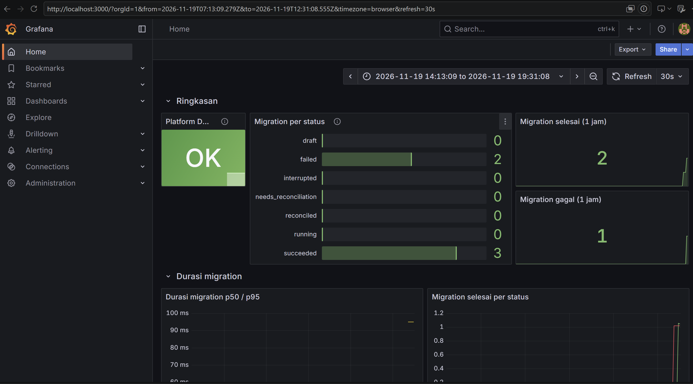

# Bonus Observability: metrik Prometheus dan dashboard Grafana

## Menjalankan

```bash
docker compose --profile observability up -d
```

| Layanan | URL | Keterangan |
|---|---|---|
| Endpoint metrik backend | http://localhost:8080/metrics | format teks Prometheus |
| Prometheus | http://localhost:9090 | scrape `backend:8080/metrics` setiap 15 detik |
| Grafana | http://localhost:3000 | login `admin` / `admin` (ubah lewat `GRAFANA_ADMIN_PASSWORD`) |

Collector, Loki, Tempo, and Grafana provisioning:

- OpenTelemetry Collector: http://localhost:4317 (gRPC) and http://localhost:4318 (HTTP)
- Loki: http://localhost:3100
- Tempo: http://localhost:3200
- Collector configuration: [`observability/otel/collector.yaml`](otel/collector.yaml)
- Loki and Tempo configuration: [`observability/loki.yaml`](loki.yaml) and [`observability/tempo.yaml`](tempo.yaml)
- Grafana data sources: [`observability/grafana/provisioning/datasources/correlation.yml`](grafana/provisioning/datasources/correlation.yml)

### Mengumpulkan log dan trace

Isi `.env` untuk mengaktifkan ekspor OTLP dari backend:

```dotenv
OTEL_EXPORTER_OTLP_ENDPOINT=http://otel-collector:4318
```

Kemudian jalankan seluruh stack observability:

```bash
docker compose --profile observability up --build -d --wait
```

Backend tetap menulis structured JSON ke stdout. Pada Compose, salinan JSON juga
ditulis ke volume `app-logs`; Collector membaca file itu dengan `filelog`, mengambil
timestamp/severity dan `trace_id`/`span_id`, lalu meneruskan log ke Loki. Trace OTLP
dikirim ke Tempo. Metrik aplikasi tetap diambil Prometheus langsung dari `/metrics`.
Saat task C menambahkan trace context pada log, trace ID dan span ID tersebut
menautkan log ke trace di Grafana. Data source Tempo juga membuka log dan query
metrik Prometheus dari rentang waktu trace.

Contoh korelasi yang diharapkan di Grafana Explore:

```text
Loki log:    event=migration_batch_committed execution_id=... trace_id=4bf92f3577b34da6a3ce929d0e0e4736 span_id=00f067aa0ba902b7
Tempo trace: API → queue → worker → database lock → batch UPDATE
Prometheus:  dbmp_migration_duration_seconds_count{status="succeeded"} 1
```

Log dan trace ID adalah atribut/metadata; jangan jadikan ID user, job, migration,
execution, ataupun SQL sebagai label Prometheus atau label Loki.

Jalankan `docker compose --profile observability logs -f otel-collector` untuk
melihat keluaran debug Collector. Di Grafana Explore, pilih Loki untuk log dan Tempo
untuk trace. Klik field `TraceID` pada log untuk membuka trace terkait.

Dashboard **DB Manager Overview** dimuat otomatis lewat provisioning:
- data source: [`observability/grafana/provisioning/datasources/prometheus.yml`](grafana/provisioning/datasources/prometheus.yml)
- dashboard: [`observability/grafana/dashboards/dbmp-overview.json`](grafana/dashboards/dbmp-overview.json)
- konfigurasi Prometheus: [`observability/prometheus/prometheus.yml`](prometheus/prometheus.yml)

Tanpa `--profile observability`, Prometheus dan Grafana tidak dijalankan, jadi `docker compose up` biasa tidak berubah.

### Mengamankan /metrics
Isi `METRICS_TOKEN` di `.env` untuk mewajibkan header `Authorization: Bearer <token>`. Lalu aktifkan blok `authorization` di `observability/prometheus/prometheus.yml` dan mount file token-nya. Di production, jangan publikasikan port 8080 langsung ke internet; biarkan `/metrics` hanya dapat dijangkau dari jaringan internal Prometheus.

## Metrik yang tersedia

Kode: [`backend/internal/metrics/`](../backend/internal/metrics/). Semua nilai dihitung saat scrape.

| Metrik | Tipe | Label | Kebutuhan tugas |
|---|---|---|---|
| `dbmp_db_pool_connections` | gauge | `state` = acquired / idle / constructing | koneksi aktif / idle |
| `dbmp_db_pool_max_connections` | gauge | - | kapasitas pool |
| `dbmp_db_pool_wait_seconds_total` | counter | - | waktu tunggu connection pool |
| `dbmp_db_pool_acquire_seconds_total` | counter | - | total waktu acquire koneksi |
| `dbmp_db_pool_acquires_total`, `dbmp_db_pool_empty_acquires_total`, `dbmp_db_pool_canceled_acquires_total` | counter | - | tekanan pada pool |
| `dbmp_migrations` | gauge | `status` | jumlah migration per status |
| `dbmp_migration_duration_seconds` | histogram | `status` | durasi migration |
| `dbmp_metrics_database_up` | gauge | - | 1 jika data migration berhasil dibaca |
| `go_*`, `process_*` | bawaan | - | kesehatan proses backend |

### Kebijakan label
Label hanya bernilai dari himpunan kecil dan tetap (`status`, `state`). **User ID, job ID, migration ID, dan SQL tidak pernah dijadikan label.** Ini dicek di integration test `TestMetricsAgainstPlatformDatabase`.

### Histogram durasi dari database
`dbmp_migration_duration_seconds` dihitung dari `started_at` / `finished_at` di `migration_entries`. Baris migration tidak pernah dihapus, sehingga nilai bucket hanya bertambah dan aman dipakai dengan `rate()` / `histogram_quantile()`.

## Menunggu Person C (queue & worker)

Metrik berikut membutuhkan queue dan worker. Nama dan labelnya disepakati di sini agar dashboard tinggal ditambah panel:

| Metrik | Tipe | Label | Dicatat di |
|---|---|---|---|
| `dbmp_jobs` | gauge | `status` (queued / running / succeeded / failed / retrying) | queue |
| `dbmp_job_retries_total` | counter | `kind` (apply / rollback / forward / batch) | worker |
| `dbmp_queue_wait_seconds` | histogram | `kind` | worker (dari enqueue sampai diambil worker) |
| `dbmp_lock_wait_seconds` | histogram | - | worker (menunggu lock database) |
| `dbmp_batches_processed_total` | counter | `outcome` (committed / failed / reverted) | worker batch |
| `dbmp_rows_processed_total` | counter | `outcome` | worker batch |

Setelah tersedia, `dbmp_jobs` menggantikan `dbmp_migrations` sebagai panel "jumlah job per status".

## Bukti

Dashboard dengan data dari platform DB lokal (2 migration gagal, 3 berhasil):



Contoh keluaran `curl http://localhost:8080/metrics`:

```text
dbmp_db_pool_connections{state="acquired"} 0
dbmp_db_pool_connections{state="idle"} 3
dbmp_metrics_database_up 1
dbmp_migrations{status="failed"} 2
dbmp_migrations{status="succeeded"} 3
dbmp_migration_duration_seconds_count{status="failed"} 2
dbmp_migration_duration_seconds_count{status="succeeded"} 3
```
